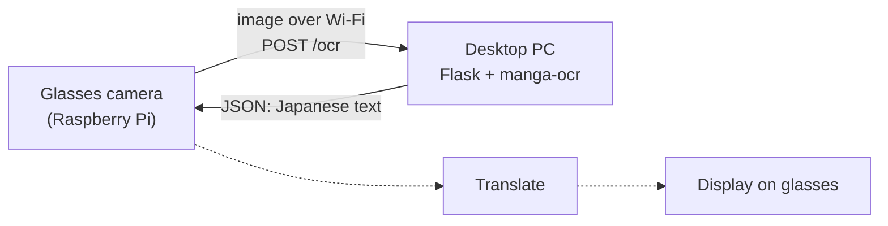

# Manga Translation Glasses

Wearable glasses that read Japanese manga text and translate it in real time. A Raspberry Pi on the glasses captures the page, and a desktop PC on the same network handles the heavy OCR work, so the wearable side stays small and cheap.

> **Status:** Work in progress. The desktop OCR server and its setup automation are done. Pi-side capture, translation and display come next (see [Roadmap](#roadmap)).

## How it works



1. The Pi camera captures a speech bubble or text region.
2. The Pi sends the image to the desktop over the local network (`HTTP POST /ocr`).
3. The desktop runs [manga-ocr](https://github.com/kha-white/manga-ocr), a Transformer model trained specifically on manga. It handles vertical text, furigana and stylized fonts that general-purpose OCR struggles with.
4. The recognized Japanese text comes back as JSON, ready to translate and show on the glasses.

**Why split it across two machines?** The OCR model is about 440 MB and too heavy to run comfortably on a Pi. Offloading it to a desktop keeps the glasses lightweight and the latency low.

## Tech stack

- **Python / Flask**: OCR HTTP server
- **manga-ocr** (Hugging Face Transformers): Japanese text recognition
- **PowerShell**: one-shot Windows provisioning
- **Raspberry Pi**: on-glasses capture (in progress)

## Repository layout

| File | Purpose |
|------|---------|
| `ocr_server.py` | Flask server exposing `POST /ocr` on port 5050 |
| `setup_manga_glasses.ps1` | Automated Windows setup: dependencies, server files, auto-start, firewall, Pi tooling |
| `start_ocr_server.bat` | Launches the OCR server in a console window |

## OCR API

`POST /ocr` with the raw image bytes as the request body. Returns `{"text": "..."}`.

```bash
curl -X POST -H "Content-Type: application/octet-stream" --data-binary @bubble.png http://localhost:5050/ocr
```

## Roadmap

- [x] Desktop OCR server
- [x] Automated Windows setup: dependencies, auto-start on login, firewall rule, LAN IP discovery
- [ ] Pi capture script (camera → `POST /ocr`)
- [ ] Translate recognized text to English
- [ ] Display the translation on the glasses

---

## Desktop setup

Requires Windows and Python 3.8+ (3.11 recommended). The setup script (`setup_manga_glasses.ps1`) handles everything else.

### Quick start

In PowerShell **run as Administrator**:

```powershell
git clone https://github.com/MuffinManss/Manga-Translation.git D:\manga_glasses
cd D:\manga_glasses
Set-ExecutionPolicy -Scope Process -ExecutionPolicy Bypass
.\setup_manga_glasses.ps1
```

The script does the following:

| Step | What happens |
|------|-------------|
| 1 | Checks Python version and PATH |
| 2 | Installs VS Code Remote-SSH extension |
| 3 | `pip install manga-ocr flask pillow` |
| 4+5 | Creates `D:\manga_ocr_server\ocr_server.py` and `.bat` launchers |
| 6 | Creates a startup shortcut so the server runs on login |
| 7 | Displays your local IP address (put this in the Pi script) |
| 8 | Adds Windows Firewall rule: Allow TCP 5050 Inbound |
| 9 | Syntax-checks the OCR server script |
| 10 | Downloads Raspberry Pi Imager to `D:\Downloads_MangaSetup\` |
| 11 | Downloads PuTTY installer to `D:\Downloads_MangaSetup\` |

### File locations after setup

```
D:\
├── manga_ocr_server\
│   ├── ocr_server.py               ← Flask OCR server (port 5050)
│   ├── start_ocr_server.bat        ← Interactive launcher (shows console)
│   └── start_ocr_server_silent.bat ← Minimized launcher (used by auto-start)
│
└── Downloads_MangaSetup\
    ├── imager_latest.exe           ← Raspberry Pi Imager installer
    ├── putty-installer.msi         ← PuTTY SSH client
    └── setup_log.txt               ← Log of what the script did
```

The auto-start shortcut `MangaOCRServer.lnk` is placed in your Windows Startup folder (`Win+R` → `shell:startup`).

### Testing the OCR server

```
cd D:\manga_ocr_server
python ocr_server.py
```

The first run downloads the ~440 MB OCR model from Hugging Face. Expected output:

```
Loading OCR model...
OCR server ready on port 5050
 * Running on all addresses (0.0.0.0)
 * Running on http://127.0.0.1:5050
```

### Desktop IP (for the Pi script)

The script prints your LAN IP at Step 7 and in the final summary, usually something like `192.168.1.x`. In the Pi script, set:

```python
OCR_SERVER_IP = "192.168.x.x"   # ← your desktop IP from Step 7
OCR_SERVER_PORT = 5050
```

### VS Code Remote SSH (editing on the Pi)

Once the Pi is set up with SSH enabled:
1. Open VS Code
2. Press `Ctrl+Shift+P` → `Remote-SSH: Connect to Host`
3. Enter `pi@192.168.x.x` (or `pi@raspberrypi.local`)

### Manual fallbacks

**Python isn't installed:** download from https://python.org/downloads/release/python-3119/ and check "Add Python to PATH" during installation.

**Remote-SSH extension install fails:** in VS Code, `Ctrl+Shift+X` → search `Remote - SSH` → install `ms-vscode-remote.remote-ssh`.

**Firewall rule wasn't added:** Windows Defender Firewall → Advanced Settings → Inbound Rules → New Rule → Port → TCP 5050 → Allow → name it `MangaOCR-Port5050`.

**Pi Imager download failed:** https://www.raspberrypi.com/software/

**PuTTY download failed:** https://www.putty.org (Windows 64-bit MSI), then `msiexec /i putty-installer.msi`

---

## Raspberry Pi setup (next phase)

1. Use **Raspberry Pi Imager** to flash Raspberry Pi OS Lite (64-bit) to an SD card. In Imager settings, enable SSH and set a username, password and Wi-Fi.
2. Boot the Pi and find its IP via your router or `ping raspberrypi.local`.
3. SSH in: `ssh pi@<pi-ip>`
4. Install the Pi-side camera script.
5. Set `OCR_SERVER_IP` in the Pi script to your desktop IP.
6. The Pi captures images → sends them to the desktop OCR server → gets text back.
